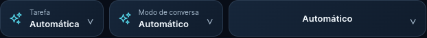

# Auren: modos, alternativas e tarefa automática

> **Etapa histórica:** a ordem e a cobertura abaixo foram substituídas pelos novos testes reais e pelo [relatório de benchmarks de 13/10/2026](AUREN-BENCHMARKS-2026-10-13.md).

Implementação em 13/10/2026. Sem novas chamadas a provedores nesta etapa, sem instalação de dependências e sem mudança no motor irmão.

## Política única de modelos

`integration/auren_routing.py` define a ordem utilizada tanto pela recomendação quanto pelas alternativas de conversa. A recomendação anterior devolvia o modelo de validação de Conversar antes de considerar o modo, tornando a escolha dos quatro modos praticamente igual.

| Modo | Primeiro modelo | Alternativas, em ordem |
|---|---|---|
| Éter | Cohere `command-a-03-2025` | NVIDIA `nvidia/nemotron-3-super-120b-a12b` → Cloudflare `@cf/mistralai/mistral-small-3.1-24b-instruct` → Mistral `ministral-14b-2512` |
| Ímpeto | Cohere `command-r7b-12-2024` | Mistral `ministral-8b-2512` → Cloudflare `@cf/meta/llama-3.1-8b-instruct-fp8` → NVIDIA `openai/gpt-oss-20b` |
| Insight | NVIDIA `nvidia/nemotron-3-super-120b-a12b` | Cohere `command-a-reasoning-08-2025` → Cloudflare `@cf/openai/gpt-oss-120b` → Cohere `command-a-03-2025` |
| Arquiteto | Cohere `command-a-03-2025` | NVIDIA `nvidia/nemotron-3-super-120b-a12b` → Cloudflare `@cf/qwen/qwen3-30b-a3b-fp8` → Mistral `ministral-14b-2512` |

Essas são ordens de preferência, sujeitas a filtros. Rotas sem evidência gratuita vigente para a credencial atual, sem credencial disponível, incompatíveis com os anexos/contexto ou em período de espera são excluídas. Não se remove conteúdo para encaixar um modelo. Um modelo manual compatível tem prioridade. A troca de modelo não troca o contexto do modo. Uma resposta parcialmente transmitida não é reiniciada em outro modelo.

A escolha favorece modelos gerais em Éter, modelos compactos em Ímpeto e modelos com contexto de análise em Insight. Arquiteto parte do modelo que já passou no teste específico de código. A documentação dos provedores sustenta a adequação declarada das famílias; **esta ordenação é uma decisão de produto, não um ranking de qualidade demonstrado em benchmark**.

Referências oficiais consultadas:

- [Modelos Cohere](https://docs.cohere.com/v1/docs/models)
- [Command R7B](https://docs.cohere.com/v1/docs/command-r7b)
- [Command A Reasoning](https://docs.cohere.com/docs/command-a-reasoning)
- [NVIDIA Nemotron 3 Super: model card](https://build.nvidia.com/nvidia/nemotron-3-super-120b-a12b/modelcard)

Nenhum contrato de API foi alterado.

### Evidência disponível e limites

Todos os modelos da tabela possuem resultados reais anteriores de resposta e verificação aritmética no inventário local. As medições anteriores são de solicitações curtas e não demonstram velocidade/qualidade em projetos longos ou disponibilidade atual garantida. Por exemplo: R7B 0,353 s; Command A 0,356 s; Ministral 8B 0,448 s; Nemotron Super/NVIDIA 1,308 s; Command A Reasoning 3,393 s. Não são tempos prometidos.

**Código, documentos e pesquisa aprofundada têm somente `command-a-03-2025` validado na tarefa específica.** Nessas tarefas, a lista efetiva permanece restrita a ele, independentemente do modo. Não foi inventada uma validação de categoria para habilitar alternativas. Transcrição mantém as rotas dedicadas validadas; voz mantém Magpie. Imagens preservam seu planejamento por perfil, independente dos modos de conversa.

## Automático

O classificador é local e explicável; não consome uma chamada adicional de modelo. Ele considera:

1. Instruções do pedido atual, normalizadas quanto a maiúsculas e acentos.
2. Verbos e objetos explícitos para imagens, pesquisa, código, documentos, voz e transcrição, em português e alguns termos em inglês.
3. Preferência por resposta breve, análise detalhada ou contexto de engenharia.
4. Áudio somente da última mensagem do usuário para inferir transcrição. Anexos anteriores continuam preservados no transporte e sujeitos à compatibilidade.
5. Continuidade textual explícita, como “corrija isso”, quando o pedido imediatamente anterior era de código, documentos ou pesquisa. Continuidade genérica não inicia nova geração de mídia.

Blocos de documento, código e citações são removidos apenas da classificação; permanecem no conteúdo enviado. Negação e instruções condicionais simples não ativam geração. Explicações como “explique como gerar uma imagem” ficam em Conversar. Pedidos mistos ou tarefas indisponíveis ficam em texto, com instrução para esclarecer o resultado ou informar a limitação.

| Exemplo | Tarefa | Contexto automático |
|---|---|---|
| “Olá” | Conversar | Éter |
| “Seja breve” | Conversar | Ímpeto |
| “Demonstre com evidências” | Conversar | Insight |
| “Explique a arquitetura de software” | Conversar | Arquiteto |
| “Implemente uma API em Python” | Gerar código | Arquiteto |
| “Compare os documentos anexos” | Analisar documentos | Insight |
| “Pesquise as novidades com fontes oficiais” | Pesquisa aprofundada | Insight |
| “Quero uma imagem de uma árvore” | Gerar imagens | Perfil Equilibrado |
| “Transcreva a gravação” | Transcrever áudio | Transporte de transcrição; anexo obrigatório |
| “Crie uma imagem e escreva código” | Conversar | Esclarecer o resultado desejado |

Escolher manualmente uma tarefa impede a detecção de outra tarefa. Um modo manual impede a alteração automática do modo. Um modelo manual compatível é tentado primeiro; incompatibilidade exige uma escolha válida, sem substituição silenciosa. A decisão de classificação acompanha os metadados da resposta, sem incluir o texto do usuário.

### Inicialização e persistência

Novas conversas começam com tarefa **Automática**, modo **Automático** e modelo **Automático**. Modelos explicitamente selecionados por pasta, URL ou seleção temporária continuam tendo prioridade. O conteúdo e os anexos dos rascunhos continuam sendo restaurados pelo fluxo existente. Conversas históricas conservam sua tarefa, seu modo e seu modelo; conversas antigas sem tarefa explícita mantêm a migração anterior para Conversar ou imagens.

## Verificação

Os testes de classificação, planejamento, persistência e interface desta etapa são locais/simulados. A gratuidade dos modelos é baseada nos testes reais anteriores registrados no inventário, sujeita à política de plano e revisão da credencial. Nenhuma nova geração real foi realizada nesta etapa e não houve gasto.

Resultados em 13/10/2026:

- **97 testes da integração/motor passaram**: classificação, política compartilhada, ordem dos fallbacks, prioridade manual, bloqueios temporários, prazo compartilhado, isolamento de eventos, anexos, configurações e regressões de mídia.
- **14 testes de backend passaram**, com banco temporário e configuração fictícia: API local, eventos, anexos, perfil e persistência de configuração.
- **42 testes de frontend passaram**, sem incluir cópias históricas da pasta privada: persistência/transição de tarefas, defaults, marca dos modelos, perfis de imagens e inicialização.
- **Build de produção concluído**. Há avisos existentes do projeto; não foi declarado que a checagem global de tipos/lint passou.
- **Interface nativa real em janela descartável**: iniciou Automática / Automático / Automático; fontes 13 px, peso 600 e altura 54 px nos três seletores. Janela estreita de 520 × 720 sem rolagem horizontal; menus estáveis; três recargas; minimizar/restaurar preservou tamanho e layout. Nenhuma geração foi acionada nessa janela.
- A primeira tentativa de interface ocorreu durante a inicialização do serviço e excedeu a espera; após o serviço responder, a verificação completa passou.
- A primeira invocação ampla usou o ambiente errado para testes de backend. A repetição usou os ambientes corretos e banco temporário. Foram corrigidos mocks antigos do cofre para que testes preparados não consultem credenciais reais.

Prévia do padrão inicial:

## Limitações

- Regras locais não compreendem toda formulação possível. Pedidos ambíguos precisam de esclarecimento.
- Não há garantia de detecção perfeita, disponibilidade permanente ou ausência de limites nos provedores.
- Faltam testes reais específicos de outras rotas para ampliar alternativas de código, documentos e pesquisa.
- Não foram habilitados vídeo, execução de código ou agentes irrestritos.
- A bateria ampla de imagens que estava pausada permanece pausada.
